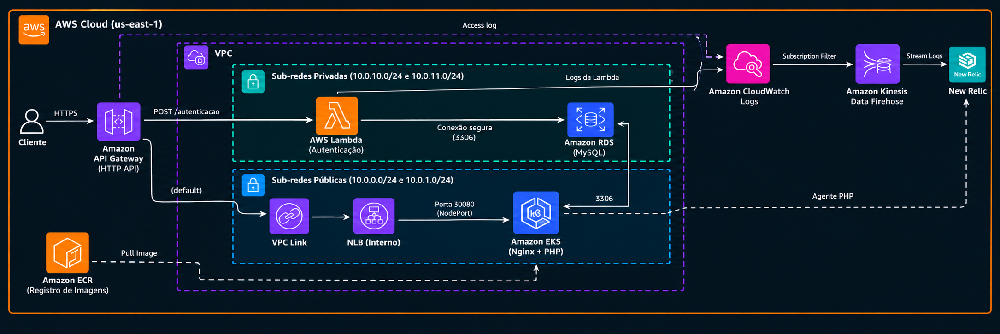

# tech-challenge-lambda

Lambda `autenticacao` do Tech Challenge. Recebe um CPF ou CNPJ, valida o documento, confirma que o cliente está cadastrado na tabela `clientes` do RDS e emite o JWT usado nas rotas protegidas da API PHP (`Authorization: Bearer <token>`).

É acessada **só pelo API Gateway** (`POST /autenticacao`). O API Gateway é criado pelo infra-k8s, e esta função registra nele a própria rota.

| Repositório | Papel |
|---|---|
| [tech-challenge-infra-k8s](https://github.com/oesleik/tech-challenge-infra-k8s) | VPC, EKS, ECR, API Gateway, New Relic |
| [tech-challenge-infra-db](https://github.com/oesleik/tech-challenge-infra-db) | Amazon RDS MySQL |
| [tech-chalange](https://github.com/oesleik/tech-chalange) | Aplicação PHP (Helm no EKS) |
| **tech-challenge-lambda** (este) | Lambda de autenticação (`POST /autenticacao`) |

Decisões: [ADR-006 (Node.js na Lambda)](https://github.com/oesleik/tech-chalange/blob/master/docs/adr/006-node-lambda.md) e [ADR-008 (acesso da Lambda ao RDS)](https://github.com/oesleik/tech-chalange/blob/master/docs/adr/008-lambda-acesso-rds.md).

## Tecnologias

- Node.js 24 (ESM), com `mysql2` como única dependência e testes com `node --test`
- AWS Lambda (arm64, dentro da VPC) e API Gateway HTTP API (payload 2.0)
- Terraform (providers `aws` e `archive`), com state remoto no S3 e lock no DynamoDB
- AWS Systems Manager Parameter Store (contrato entre repositórios)
- New Relic: logs via subscription no Firehose do infra-k8s (quando ele está ligado). As métricas vêm do API polling
- GitHub Actions com OIDC

## API

Especificação: [`docs/openapi.yaml`](docs/openapi.yaml). Dá para abrir no [Swagger Editor](https://editor.swagger.io/) ou importar no Postman. As demais rotas, servidas pelo PHP, estão no Swagger do [tech-chalange](https://github.com/oesleik/tech-chalange#-acessos) (`<api_gateway_url>/docs/index.html`).

```bash
curl -X POST "$(terraform -chdir=terraform output -raw autenticacao_url)" \
  -H 'content-type: application/json' -d '{"cpf_cnpj": "529.982.247-25"}'
```

| Caso | Status | Body |
| --- | --- | --- |
| CPF/CNPJ válido e cliente cadastrado | 200 | `{"access_token": "<jwt>", "token_type": "Bearer", "expires_in": 3600}` |
| CPF/CNPJ inválido | 401 | `{"error": "Unauthorized", "message": "CPF/CNPJ inválido."}` |
| CPF/CNPJ válido sem cliente cadastrado | 404 | `{"error": "Not Found", "message": "Cliente não encontrado."}` |
| Sem `cpf_cnpj` (string) ou JSON inválido | 400 | `{"error": "Bad Request", "message": "..."}` |
| `JWT_SECRET` ou `DB_*` ausentes | 500 | `{"error": "Internal Server Error", ...}` |
| Falha ao consultar o banco | 503 | `{"error": "Service Unavailable", ...}` |

### CPF/CNPJ

O campo é `cpf_cnpj`. O campo `cpf` do contrato original continua aceito como alias, e `cpf_cnpj` tem prioridade quando os dois vêm no body.

- **CPF:** aceita com ou sem `.` e `-`. Diferente do `Cpf.php`, rejeita caracteres não numéricos e dígitos repetidos (`111.111.111-11`).
- **CNPJ:** aceita com ou sem `.`, `/` e `-`, inclusive o alfanumérico (`12.ABC.345/01DE-35`), em maiúsculas ou minúsculas. Usa o mesmo algoritmo do `Cnpj.php`, mas rejeita DVs não numéricos e sequências repetidas.

### Token

HS256 assinado com `JWT_SECRET`, compatível com `src/Core/Auth/AbstractJwtService.php` do PHP. Claims: `iss` (`JWT_ISSUER`), `iat`, `exp` (`iat + JWT_TTL`), `sub` (CPF/CNPJ normalizado, como em `clientes.cpf_cnpj`) e `role` (`cliente`).

## Arquitetura



O diagrama mostra a solução inteira. Este repositório cria a **AWS Lambda (Autenticação)** nas sub-redes privadas, com seu security group, e o log group no CloudWatch (7 dias).

Ele também cria recursos dentro de componentes de outros repositórios:

- **API Gateway:** integração, rota `POST /autenticacao` e permissão de invocação. A rota específica tem precedência sobre o `$default`, que vai para o PHP.
- **Security group do RDS:** a regra de ingress 3306 a partir do SG da Lambda. Quem sobe depois cria o acesso. Por isso o destroy do infra-db exige que esta Lambda tenha saído antes.
- **Firehose:** a subscription filter do log group da Lambda, quando `observability/*` existe no SSM (New Relic ligado).

## Contrato SSM

Consumido ([`terraform/contract.tf`](terraform/contract.tf)):

| Parâmetro | Publicado por | Uso |
|---|---|---|
| `network/vpc_id`, `network/private_subnet_ids` | infra-k8s | SG e `vpc_config` |
| `apigw/api_id`, `apigw/execution_arn`, `apigw/invoke_url` | infra-k8s | Rota, permissão, output da URL |
| `observability/*` (opcional) | infra-k8s | Subscription de logs no Firehose |
| `db/address`, `db/port`, `db/name`, `db/security_group_id` | infra-db | Env vars e regras de SG |
| `app/*` (só existência, checado no workflow) | tech-chalange | Garante que o usuário MySQL `autenticacao` já foi criado |

Publicado: `/tech-challenge/lambda/autenticacao_function_name`. Serve de marcador "Lambda de pé" para os destroys do infra-db e do infra-k8s.

### Variáveis de ambiente da função

| Variável | Origem |
| --- | --- |
| `JWT_SECRET` | secret `JWT_SECRET` (**igual** ao do tech-chalange) |
| `JWT_ISSUER`, `JWT_TTL` | `jwt_issuer` / `jwt_ttl` (padrões iguais aos do PHP) |
| `DB_HOST`, `DB_PORT`, `DB_DATABASE` | SSM `db/*` |
| `DB_USERNAME` | `lambda_db_username` (padrão `autenticacao`) |
| `DB_PASSWORD` | secret `LAMBDA_DB_PASSWORD` (**igual** ao do tech-chalange, usado pelo job `rds-user-setup`) |
| `DB_SSL` | não definida: TLS com o bundle do RDS. `false` desliga, só para MySQL local |

## Pré-requisitos

Setup manual da conta (bucket do state, tabela de lock, role OIDC): ver [runbook AWS](https://github.com/oesleik/tech-chalange/blob/master/docs/infrastructure/runbook_aws.md).

| Tipo | Nome | Uso |
|---|---|---|
| Variable | `AWS_ROLE_ARN_APPLY` | Role OIDC de deploy/destroy |
| Variable | `TF_STATE_BUCKET` | Bucket S3 do state |
| Variable | `TF_STATE_LOCK_TABLE` | Tabela DynamoDB de lock |
| Secret | `JWT_SECRET` | Assinatura do token (32+ bytes), igual ao do PHP |
| Secret | `LAMBDA_DB_PASSWORD` | Senha do usuário MySQL `autenticacao`, igual à do tech-chalange |

Os secrets ficam duplicados entre os repositórios. Se divergirem, a falha aparece só em runtime: token rejeitado pelo PHP (401) ou erro de acesso ao banco (503).

## Desenvolvimento

```bash
npm ci
npm test
```

O handler recebe o acesso ao banco por injeção (`criarHandler`), então os testes não precisam de MySQL.

## Deploy

**Actions → Deploy → Run workflow** (branch `master`). É o **último** da cadeia: depende do infra-k8s, do infra-db e da app, porque é o job `rds-user-setup` da app que cria o usuário MySQL da Lambda. O workflow:

1. Verifica o contrato SSM (rede, API Gateway, banco, e se `app/` existe). Se faltar algo, aborta dizendo qual repositório subir antes.
2. Roda os testes e `npm run build`, que monta `build/` com `src/`, `package.json` e o `node_modules` de produção.
3. Roda `terraform plan` e `apply` (state `tech-challenge/lambda.tfstate`). O `archive_file` zipa `build/`.

```
Deploy:  infra-k8s → infra-db → app → lambda
Destroy: lambda → app → infra-db → infra-k8s
```

O **Destroy** remove a função, a rota, a regra no SG do RDS e o parâmetro `lambda/`, o que libera o destroy dos outros repositórios. As ENIs da Lambda na VPC levam alguns minutos para sumir.

### Execução local (opcional)

```bash
npm ci && npm run build
cd terraform
terraform init \
  -backend-config="bucket=<TF_STATE_BUCKET>" \
  -backend-config="key=tech-challenge/lambda.tfstate" \
  -backend-config="region=us-east-1" \
  -backend-config="dynamodb_table=<TF_STATE_LOCK_TABLE>"
TF_VAR_jwt_secret='...' TF_VAR_lambda_db_password='...' terraform plan -var-file=env/aws.tfvars
```

## CI

[`ci.yml`](.github/workflows/ci.yml) roda em PR e em push na `master`, em dois jobs: testes (`npm ci` + `npm test`) e Terraform (`fmt -check`, `init -backend=false`, `validate`). Nenhum dos dois usa credenciais AWS.
